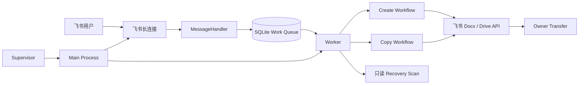

# 飞书创建模板机器人

> Portfolio Edition：这是从实际工程经验中整理出的独立发布副本，不包含生产凭证、业务数据、内部服务、运行日志或原始 Git 历史。

一个使用飞书官方 Python SDK 和长连接接收消息的文档机器人。它解决员工需要通过统一入口创建或复制文档、同时避免事件重投造成重复写入的问题。支持通过群聊或单聊创建新版飞书文档、复制 docx 文档，并把最终所有权转给指令发起人。

## 系统目标

- 使用应用身份完成文档创建与复制。
- 使用 `message_id` 和 SQLite 状态机保证外部写入幂等。
- 把 CREATE、COPY、Owner Transfer 三类副作用纳入检查点与恢复流程。
- 在日志、配置和异常中保护凭证与用户标识。
- 保持部署简单，不引入当前规模不需要的消息中间件。

## 功能

- `创建文档`：在配置的公共目录创建新版文档。
- `复制副本 <飞书文档链接>`：把 docx 副本放入配置的公共目录。
- `测试`：检查机器人长连接。
- `帮助` / `help`：显示使用说明。
- SQLite 持久化 `message_id` 幂等和操作检查点。
- CREATE、COPY、Owner Transfer 出现不确定结果时禁止自动重复外部写入。
- Main/Worker 心跳、恢复扫描和 Windows Supervisor。

## 技术栈

- Python 3.12
- 飞书官方 Python SDK `lark-oapi`
- 飞书长连接事件订阅
- SQLite 持久化队列与 operation state
- Python `unittest`、`unittest.mock`
- Windows Supervisor 与单实例文件锁

## 系统架构



完整说明见 [架构文档](docs/architecture.md)。

## 核心执行流程

1. 长连接接收 `im.message.receive_v1`。
2. 解析群聊 `@机器人` 或单聊指令。
3. 先把 `message_id` 和 operation 写入 SQLite，再交给 Worker。
4. 外部写入前保存 `BEFORE_EXTERNAL_WRITE`。
5. API 成功返回资源 Token 后立即保存 `AFTER_EXTERNAL_WRITE`。
6. Owner Transfer 每个 operation 最多主动执行一次。
7. Worker 崩溃后，新 Worker 先做只读恢复，不重复 CREATE/COPY。

## 技术难点与解决方案

### 外部 API 成功但本地进程崩溃

文档可能已经创建，但最终 SUCCESS 尚未保存。项目在外部写入前后保存检查点和资源 Token；恢复时根据已知 Token 做只读核验，禁止再次创建。

### 飞书事件重投

SQLite 以 `message_id` 作为幂等键。同一消息只能建立一个 CREATE 或 COPY operation，不同消息仍可独立执行。

### Owner Transfer 的不确定结果

每个 operation 最多主动调用一次所有权转移。明确失败进入 PARTIAL，超时或崩溃进入 AMBIGUOUS，均不会重新创建或复制文档。

### 富文本链接输入

解析器支持裸 URL 和飞书富文本转换后的 Markdown 链接，同时拒绝非飞书域名、非 HTTPS、多链接和不支持的资源类型。

设计取舍见 [设计决策](docs/design-decisions.md)。

## 安全边界

- `.env`、运行数据库和日志不会进入 Git。
- App Secret 仅从本地 `.env` 读取。
- 创建和复制分别使用独立 Gate；首次配置建议保持关闭。
- 不会回退到机器人根目录或其他未知目录。
- 所有权转移每个 operation 最多主动调用一次。
- 源文档只接受经过校验的飞书 docx 链接，不会请求任意用户 URL。
- 公开版本使用本地空观测适配器，不包含内部日志系统或数据库连接。

## 安装

需要 Python 3.12。

```powershell
python -m venv .venv
.\.venv\Scripts\python.exe -m pip install -r requirements.txt
Copy-Item .env.example .env
```

编辑 `.env`，填写飞书 App ID、App Secret 和目标目录 Token。先在飞书开放平台启用机器人、长连接事件订阅和所需云文档权限。

## 配置

```dotenv
FEISHU_APP_ID=your_app_id
FEISHU_APP_SECRET=your_app_secret
FEISHU_PUBLIC_FOLDER_TOKEN=your_folder_token
AI_TEMPLATE_BOT_ENABLE_REAL_CREATE=false
AI_TEMPLATE_BOT_ENABLE_REAL_COPY=false
```

确认权限和目录配置后，再分别将需要开放的 Gate 改为 `true`。

## 运行

```powershell
.\.venv\Scripts\python.exe main.py
```

## 测试

```powershell
.\.venv\Scripts\python.exe -m unittest discover -p "test_*.py"
```

测试使用 mock，不会调用真实飞书文档写接口。当前结果：`124 tests, 124 passed, 0 skipped`。

覆盖范围包括配置 fail-fast、链接解析、CREATE/COPY 幂等、UNKNOWN/AMBIGUOUS 禁止重试、Owner Transfer 单次调用、Worker 崩溃恢复、Main 单实例和敏感信息脱敏。详情见 [测试说明](docs/testing.md)。

## 项目目录

```text
├── main.py                  # 启动入口
├── app_factory.py           # 依赖组装
├── config.py                # 配置与安全 Gate
├── message_handler.py       # 飞书事件解析与路由
├── create_workflow.py       # 创建状态机
├── copy_workflow.py         # 复制状态机
├── operation_store.py       # CREATE operation 持久化
├── copy_store.py            # COPY operation 持久化
├── work_queue.py            # 持久任务队列
├── worker_runtime.py        # Worker、心跳与恢复
├── reconciliation.py       # 只读恢复核验
├── supervisor.py           # Main 自动拉起
├── test_*.py               # 离线测试
└── docs/                   # 架构、决策、测试与排障
```

## 演示结果

- 离线回归：124/124 通过。
- 真实飞书 E2E、生产目录 Token 和运行证据不随公开版本发布。
- 若没有自己的飞书应用和对应权限，只能运行离线测试，无法执行真实文档操作。

## 已知限制

- COPY 当前只支持新版飞书文档 `docx`。
- SQLite 适合单机部署；多机水平扩展需要共享存储和分布式锁设计。
- UNKNOWN/AMBIGUOUS 状态需要人工核验，系统不会冒险重试外部写入。
- Windows Supervisor 只负责 Main 进程拉起，不替代完整的服务编排平台。

## 个人贡献与 AI 辅助

个人负责业务规则确认、风险边界、状态机验收、真实故障场景验证和发布决策。代码实现、测试补全、文档整理和问题排查过程中使用了 AI 编程工具辅助；所有外部副作用 Gate、测试结果和最终行为均经过人工确认。

常见问题见 [故障排查](docs/troubleshooting.md)。
