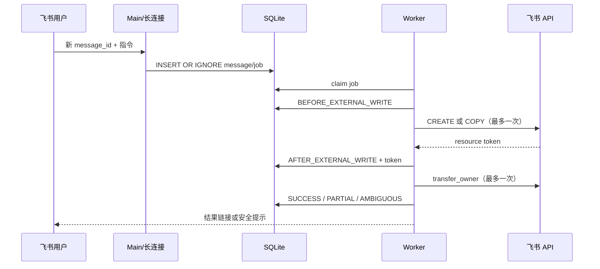

# 系统架构

## 组件职责

| 组件 | 职责 |
|---|---|
| `message_handler.py` | 清洗群聊 mention、解析富文本、识别指令并落持久队列 |
| `work_queue.py` | 保存待处理任务、claim 状态、Worker 心跳和恢复通知状态 |
| `worker_runtime.py` | 消费任务、检测 Worker 崩溃、启动新 Worker、执行 recovery scan |
| `create_workflow.py` | CREATE 状态机、外部写入检查点、Owner Transfer |
| `copy_workflow.py` | COPY 状态机、源文档核验、Owner Transfer |
| `operation_store.py` / `copy_store.py` | operation 幂等和状态持久化 |
| `reconciliation.py` | 对已有资源进行只读核验，禁止恢复阶段重复写入 |
| `supervisor.py` | Main 异常退出后的自动拉起 |

## 数据流

## 恢复原则

- `message_id` 是消息级幂等边界。
- API 已发出但结果未知时，operation 进入 UNKNOWN/AMBIGUOUS。
- 已保存资源 Token 时，恢复流程只读核验该资源。
- 日志或通知失败不允许触发 CREATE/COPY 重试。
